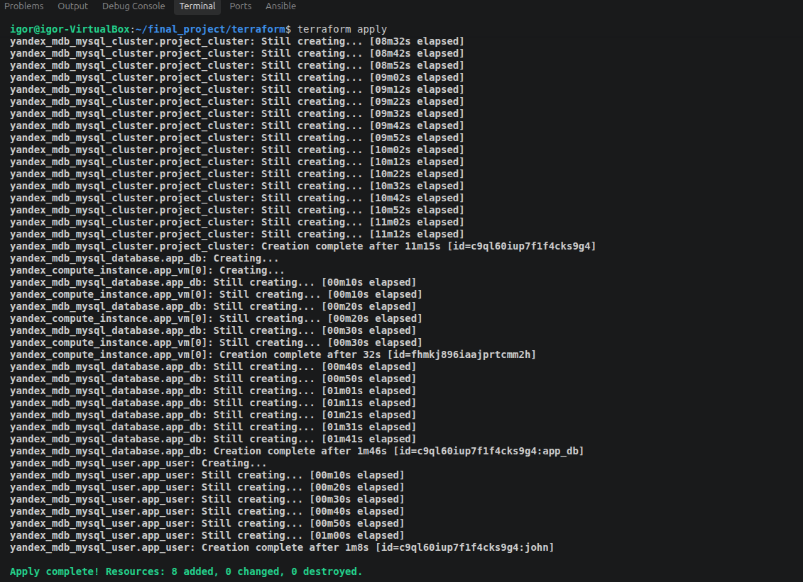
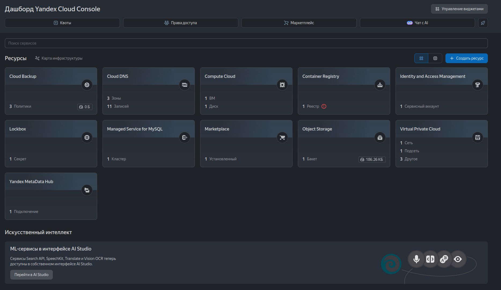
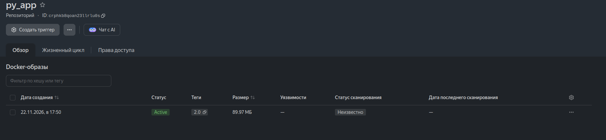
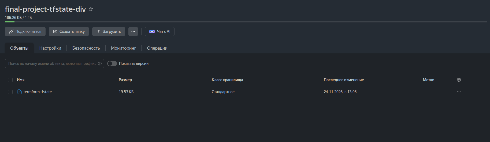
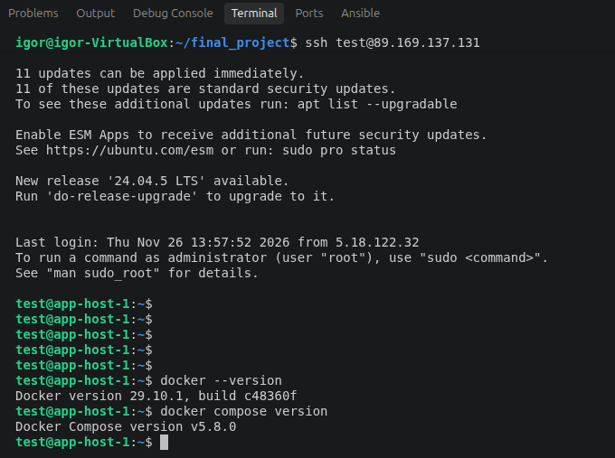
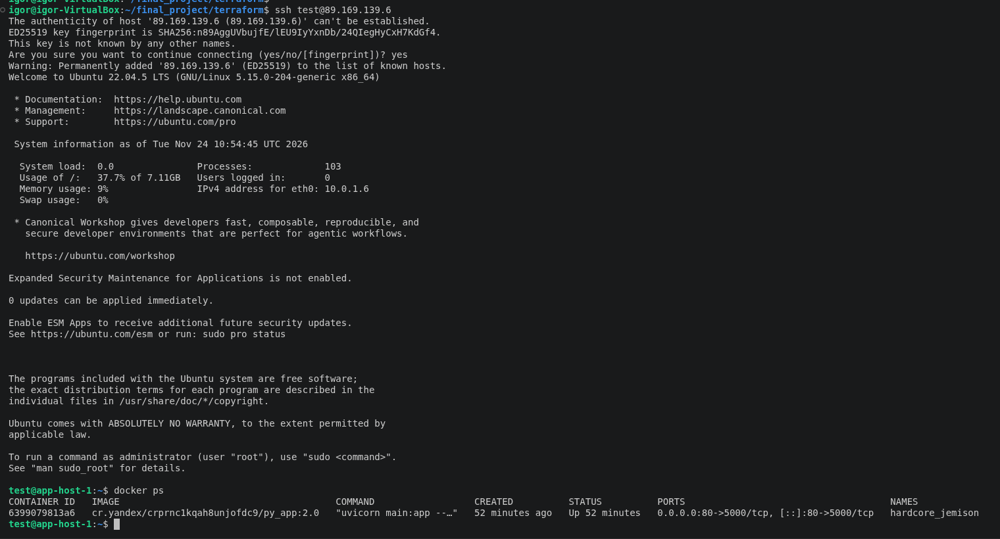
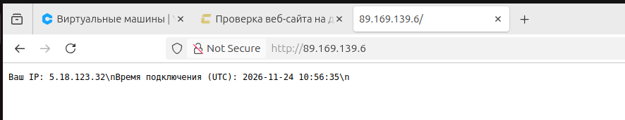
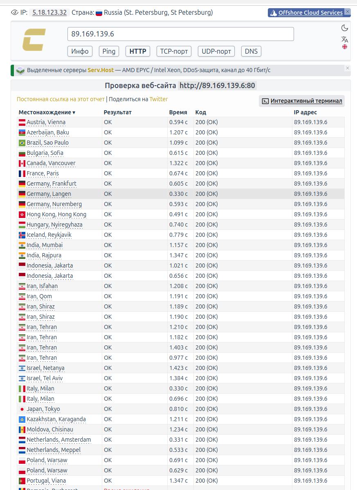
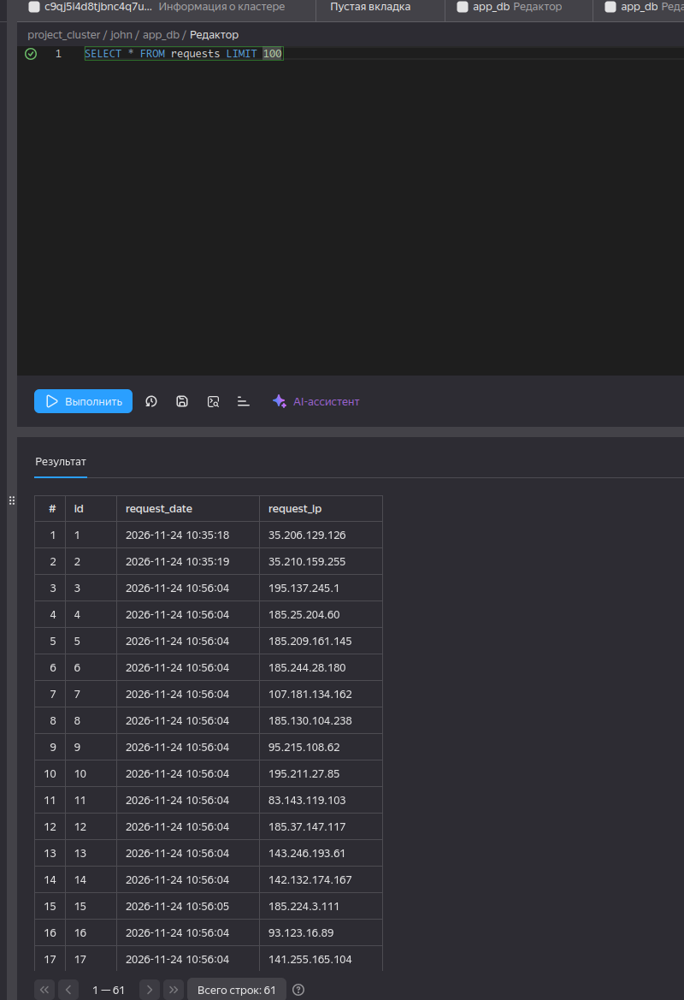

# Итоговый проект модуля «Облачная инфраструктура. Terraform» Дедяхин Игорь

**Задание 1.** Развертывание инфраструктуры в Yandex Cloud.
1.1 Создайте Virtual Private Cloud (VPC).

1.2 Создайте подсети.

1.3 Создайте виртуальные машины (VM):

1.3.1 Настройте группы безопасности (порты 22, 80, 443).

1.3.2 Привяжите группу безопасности к VM.

1.4. Опишите создание БД MySQL в Yandex Cloud.

1.5. Опишите создание Container Registry.

**Задание 2.** Используя user-data (cloud-init), установите Docker и Docker Compose (см. Задания 5 модуля «Виртуализация и контейнеризация»).

**Задание 3.** Опишите Docker файл (см. Задания 5 «Виртуализация и контейнеризация») c web-приложением и сохраните контейнер в Container Registry. 

**Задание 4.** Завяжите работу приложения в контейнере на БД в Yandex Cloud.


### Решение

**Задание 1.** 

1.1 VPC и подсеть описаны в файле [vpc.tf](terraform/vpc.tf)

1.2 Виртуальные машины описаны в файле [vms.tf](terraform/vms.tf), переменной  ```app_vm_count``` задается кол-во ВМ.

1.3 Группы безопасности описаны в файле [security_groups.tf](terraform/security_groups.tf) и привязаны к ВМ перменные для групп безопасности описаны в файле [sec_groups_vars.tf](terraform/sec_groups_vars.tf)

1.4 Создание БД MySQL описано в файле [mysql.tf](terraform/mysql.tf)

1.5 Создание Container Registry описано в файле [registry.tf](terraform/registry.tf), переменные в файле [registry_vars.tf](terraform/registry_vars.tf)

1.6 В файле [providers.tf](terraform/providers.tf) описано удаленное хранение state, подключен statelocking

1.7 В файле [variables.tf](terraform/variables.tf) заданы перменные для облака, vpc, подсети, ВМ и БД


**Задание 2.**

Используя [cloud-init.yaml.tpl](terraform/cloud-init.yaml.tpl) на ВМ устанавливается Docker и Docker Compose


**Задание 3.**

С помощью  [Dockerfile](py_app/Dockerfile) создается образ с web-приложением [main.py](py_app/main.py). Образ сохранен в Container Registry.

**Задание 4.**

Работа приложения завязана на БД в Yandex Cloud. Приложение запускается через [cloud-init.yaml.tpl](terraform/cloud-init.yaml.tpl) необходимые реквизиты для подключения к БД передаются через переменные с помощью локальных значений из [locals.tf](terraform/locals.tf)


### Демонстрация работы

Результат выполнения `terraform apply`:



Ресурсы созданы (из-за ограничений ЯО создана одна вм):



Образ хранится в Container Registry:



tfstate в хранилище:



После подключения по ssh к ВМ проверяем установку docker и docker compose, работу контейнера :





Проверяем работу приложения:






Проверяем работу БД:



